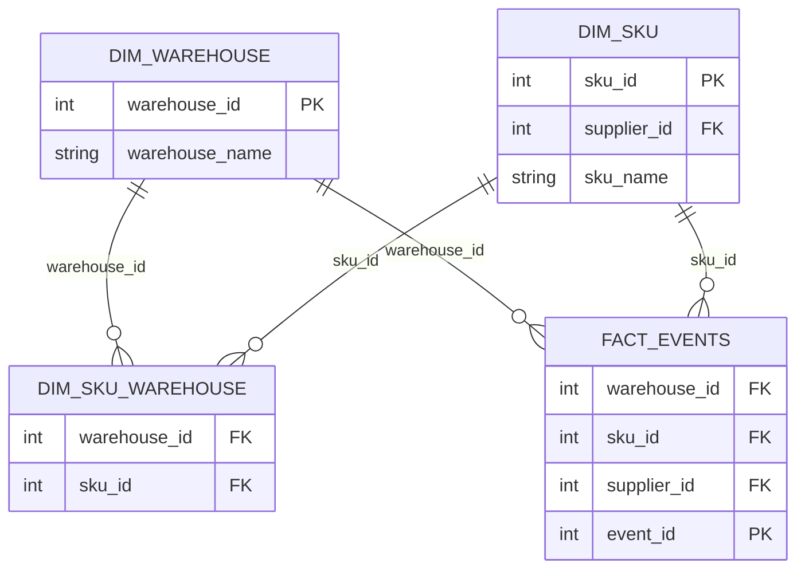

# Statistics-Notes

# What Is Statistics?

Statistics is a mathematical discipline concerned with:

1. Collecting data
2. Organizing data
3. Summarizing data
4. Interpreting data

It provides systematic techniques to reduce complexity and improve decision-making.
Statistics is the science of collecting, organizing, analyzing, interpreting, and presenting data so we can make sense of the world and make better decisions.
# Why Learn Statistics?

Learning statistics transforms raw, chaotic data into clear, actionable decisions. Without statistics, we rely on intuition and gut feeling; with statistics, we turn observations into predictable patterns, quantify risk, and test whether something works by chance or by design.

# Core Reasons to Learn Statistics
**Make Data-Driven Decisions:** Move from guessing ("I think this ad works") to knowing ("This ad increases conversions by 14% with 95% confidence").

**Quantify Risk & Uncertainty:** Understand variance so you don't panic over short-term fluctuations or trust an unstable process.

**Detect Patterns & Correlations:** Identify hidden relationships between variables (e.g., studying hours vs. exam scores, diet vs. blood pressure).

**Avoid Being Misled:** Recognize skewed data, cherry-picked metrics, and misleading averages presented in news or marketing.

**Practical Real-World Example: Choosing a Restaurant (Mean vs. Standard Deviation)**

Imagine you are choosing between two restaurants based on customer rating scores (out of 10) from 5 customers: 
**Restaurant A**: 8, 8, 8, 8, 8 
**Mean ($\bar{x}$):** $8.0$ 
**Standard Deviation ($s$):** $0.0$ (Zero variation — perfectly consistent experience every time) 
**Restaurant B:** 2, 10, 2, 10, 16 (Note: scaled rating system where top scores vary) 
**Mean ($\bar{x}$)**: $8.0$ 
**Standard Deviation ($s$)**: $6.0$ (High variation — hit-or-miss experience) 

# Data Warehouse Schema

This diagram represents the relationships between warehouse, SKU,
and event tables.

# Step 1: Import libraries
import numpy as np
import tensorflow as tf
import matplotlib.pyplot as plt

from sklearn.model_selection import train_test_split
from sklearn.metrics import accuracy_score

# Step 2: Create a small dataset
hours = np.array([
    1, 2, 3, 4, 5, 6, 7, 8, 9, 10,
    1.5, 2.5, 3.5, 4.5, 5.5, 6.5, 7.5, 8.5, 9.5, 10.5
], dtype=np.float32)

# 0 = Fail, 1 = Pass
labels = (hours >= 4).astype(np.float32)

# Step 3: Split the dataset
X_train, X_test, y_train, y_test = train_test_split(
    hours.reshape(-1, 1),
    labels,
    test_size=0.25,
    random_state=42,
    stratify=labels
)

# Step 4: Build a single-layer perceptron
tf.keras.utils.set_random_seed(42)

model = tf.keras.Sequential([
    tf.keras.layers.Input(shape=(1,)),
    tf.keras.layers.Dense(1, activation="sigmoid")
])

# Step 5: Compile the model
model.compile(
    optimizer=tf.keras.optimizers.SGD(learning_rate=0.1),
    loss="binary_crossentropy",
    metrics=["accuracy"]
)

# Step 6: Train the model
history = model.fit(
    X_train,
    y_train,
    epochs=200,
    verbose=0
)

# Step 7: Evaluate the model
loss, keras_accuracy = model.evaluate(
    X_test, y_test, verbose=0
)

probabilities = model.predict(X_test, verbose=0)
predictions = (probabilities >= 0.5).astype(int).flatten()

accuracy = accuracy_score(y_test, predictions)

print("Test Loss:", round(loss, 4))
print("Test Accuracy:", round(accuracy * 100, 2), "%")

print("\nActual vs Predicted:")
for actual, predicted in zip(y_test.astype(int), predictions):
    print(f"Actual: {actual}, Predicted: {predicted}")

# Step 8: Plot the training loss curve
plt.figure(figsize=(8, 5))
plt.plot(history.history["loss"])
plt.title("Perceptron Training Loss Curve")
plt.xlabel("Epoch")
plt.ylabel("Binary Cross-Entropy Loss")
plt.grid(True)
plt.show()

Test Loss: 0.2262
Test Accuracy: 100.0 %

Actual vs Predicted:
Actual: 0, Predicted: 0
Actual: 0, Predicted: 0
Actual: 1, Predicted: 1
Actual: 1, Predicted: 1
Actual: 1, Predicted: 1

